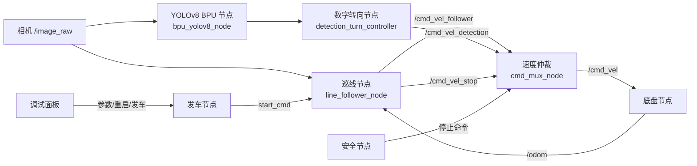

# AIC 智能车视觉规划系统技术文档

## 1. 项目概述

本项目面向 2026 AIC 智能车视觉规划赛，运行平台为 RDK X5、Wheeltec 小车底盘和 ROS 2。系统以单目 RGB 摄像头为主要感知设备，完成黑色边界识别、赛道跟踪、弯道控制、黄色停车线处理、红色目标避让、随机数字识别和底盘速度仲裁。

当前版本采用分层结构：图像处理、赛道几何、状态机、运动控制和调试显示分别实现，ROS 2 节点负责数据接入与消息发布，启动脚本负责整车进程管理，仿真工具负责离线验证和参数搜索。

版本基线：`0e50d1e`（重构巡线算法并合并上游仿真、面板和诊断工具）。

## 2. 系统组成

### 2.1 软件结构



### 2.2 代码目录

| 目录 | 内容 |
|---|---|
| `src/line_follow_ws/src/line_follower` | 巡线、数字转向、速度仲裁和发车节点 |
| `src/line_follow_ws/src/line_follower/include/line_follower` | 感知、几何、状态机和控制接口 |
| `src/line_follow_ws/src/line_follower/src` | C++ 实现 |
| `src/line_follow_ws/src/line_follower/config` | 默认 ROS 2 参数 |
| `src/line_follow_ws/src/line_follower/launch` | 单巡线和联合启动文件 |
| `src/yolov8` | RDK X5 BPU YOLOv8 数字检测节点 |
| `src/camera` | 相机输入节点 |
| `src/car_ws` | Wheeltec 底盘、串口、里程计和机器人描述 |
| `tools/config` | 岔路和环岛运行参数 |
| `tools/sim` | 赛道仿真、参数搜索和轨迹渲染 |
| `tools/panel` | 浏览器调试面板和参数服务 |
| `tools/start.sh`、`tools/wrap.sh` | 整车启动、进程管理和日志分段 |

## 3. 感知与控制算法

### 3.1 图像分割

`ImageProcessor` 对每帧 BGR 图像执行 ROI 截取、高斯滤波、灰度阈值分割、HSV 白色过滤、黄色线检测和形态学处理，输出二值图、黄色线标志和有效轮廓。

| 参数 | 作用 | 当前配置 |
|---|---|---|
| `roi_top_ratio` | ROI 上边界 | 岔路 `0.65`，环岛 `0.60` |
| `roi_bottom_ratio` | ROI 下边界 | `0.20` |
| `binary_threshold` | 灰度分割阈值 | `160` |
| `morph_kernel` | 形态学核大小 | `3` |
| `morph_iterations` | 形态学迭代次数 | `2` |
| `min_contour_area` | 最小有效轮廓面积 | `2500` |
| `use_white_filter` | 白色道路筛选 | `true` |
| `use_yellow_filter` | 黄色线筛选 | `true` |

### 3.2 近带与远带几何

`LaneGeometry` 在 ROI 内建立近带和远带。近带反映车头附近的位置，远带反映前方道路趋势；每个带计算中心、边界、宽度、可靠度和归一化误差，再融合为横向误差、航向代理量和曲率代理量。

环岛配置提高远带占比并启用宽赛道自适应：

```yaml
far_band_top_ratio: 0.22
far_band_bottom_ratio: 0.42
near_band_top_ratio: 0.50
near_band_bottom_ratio: 0.72
near_band_weight: 0.52
far_band_weight: 0.48
enable_width_adaptive_fusion: true
```

### 3.3 连续弯辅助与视觉前馈

当近带和远带误差方向相反、误差达到阈值并持续满足确认帧数时，系统进入连续弯状态，降低速度并调整航向增益。该逻辑用于处理环岛空白区域，提前保持转向趋势。

```yaml
enable_continuous_curve_assist: true
reverse_curve_min_error: 0.12
reverse_curve_threshold: 0.35
reverse_curve_confirm_frames: 3
reverse_curve_clear_frames: 4
reverse_curve_speed: 0.32
sharp_curve_threshold: 0.50
sharp_curve_speed: 0.36
```

视觉前馈使用远带与近带的带符号差提前修正航向，默认关闭，完成底盘转向特性测试后再逐步开启：

```yaml
steer_ff_gain: 0.0
steer_ff_use_v: false
```

### 3.4 运动控制

`MotionController` 根据横向误差、航向代理量、曲率代理量和观测置信度计算速度与角速度：

```text
yaw = clamp(-(kp * lateral_error + heading_gain * heading_proxy))
speed = target_speed * (1 - speed_gain_damping * slow_factor)
slow_factor = deviation_weight * deviation + curve_weight * curvature
```

关键参数：

| 参数 | 岔路 | 环岛 | 作用 |
|---|---:|---:|---|
| `target_speed` | 0.50 | 0.55 | 目标线速度 |
| `max_speed` | 0.50 | 0.55 | 速度上限 |
| `kp` | 3.30 | 2.45 | 横向误差增益 |
| `max_yaw_rate` | 1.50 | 2.00 | 角速度上限 |
| `speed_gain_damping` | 0.22 | 0.90 | 弯道降速强度 |
| `heading_gain` | 默认 0 | 0.85 | 航向修正增益 |

低置信度时限制速度并保持上一帧转向；丢线时按短时保持、低速搜索和完整停车三个阶段处理。

### 3.5 黄色停车线状态机

`TrackStateMachine` 维护黄色线锁存、停车计数、里程计静止状态和丢线计时。黄色线连续出现时锁存一次检测事件；未达到最终计数时短暂停车，达到计数后进入最终停车；短暂停车结合 `/odom` 判断车辆静止，黄色线连续消失后解除锁存。

```yaml
yellow_stop_min_time: 0.35
odom_still_threshold: 0.02
odom_still_hold: 0.25
yellow_stop_duration: 1.0
yellow_permanent_count: 4
yellow_clear_frames: 10
```

### 3.6 红色目标避让

红色检测使用 HSV 双区间提取红色像素，并按轮廓宽高比和画面宽度区分红色禁行线与红色锥桶。目标底部位置用于距离估计，道路走廊判断目标是否位于行驶路径内，连续投票确认避让方向，软避让控制将斥力叠加到巡线控制并保持最低前进速度。

```yaml
enable_red_filter: true
enable_soft_red_avoidance: true
red_cone_area_ratio_threshold: 0.0006
red_near_ratio: 0.38
red_very_close_ratio: 0.72
red_corridor_half_width_ratio: 0.35
red_soft_yaw: 0.15
red_repulsion_gain: 1.50
red_min_forward_speed: 0.15
```

### 3.7 随机数字识别与转向

`bpu_yolov8_node.py` 订阅 `/image_raw`，将图像缩放到 `640×640` 并转换为 NV12，在 RDK X5 BPU 上完成 YOLOv8 推理、DFL 解码和 NMS，发布 `ai_msgs/msg/PerceptionTargets` 到 `/hobot_dnn_detection`，按需发布 `/yolo_detection_image`。

检测节点采用最新帧单槽位异步处理，检测结果先于调试图发布，调试图默认限制为 6 FPS。

| 参数 | 默认值 | 作用 |
|---|---:|---|
| `conf_thresh` | 0.25 | 置信度阈值 |
| `iou_thresh` | 0.55 | NMS 阈值 |
| `nms_top_k` | 20 | 最大检测框数 |
| `min_box_size` | 6 | 最小检测框尺寸 |
| `async_latest_frame` | true | 最新帧异步推理 |
| `debug_image_max_fps` | 6 | 调试图最高频率 |

`detection_turn_controller` 对检测结果进行窗口累计、置信度排序、位置一致性判断和转向恢复，输出 `/cmd_vel_detection`。

### 3.8 速度仲裁

`cmd_mux_node` 按优先级输出最终速度：

```text
/cmd_vel_stop  >  /cmd_vel_detection  >  /cmd_vel_follower
```

默认超时为停止命令 `0.5 s`、数字转向命令 `0.12 s`。输入超过有效时间后自动降级到下一优先级，最终输出为 `/cmd_vel`。

## 4. 参数配置

### 4.1 岔路配置

文件：`tools/config/fork.yaml`

```yaml
track_mode: fork
target_speed: 0.50
max_speed: 0.50
kp: 3.30
max_yaw_rate: 1.50
speed_gain_damping: 0.22
```

岔路配置强调横向误差跟踪和直道速度，适合分叉、汇合和较短弯道。

### 4.2 环岛配置

文件：`tools/config/roundabout.yaml`

```yaml
track_mode: roundabout
target_speed: 0.55
max_speed: 0.55
kp: 2.45
max_yaw_rate: 2.00
speed_gain_damping: 0.90
heading_gain: 0.85
```

环岛配置强调远端趋势、宽赛道自适应和连续弯控制。

参数修改后重启对应节点，启动日志中的 `[DEC] param effective` 显示实际生效值。

## 5. 编译与运行

### 5.1 编译

```bash
cd ~/aic-
source /opt/tros/humble/setup.bash
colcon build --symlink-install --packages-select line_follower
source install/setup.bash
```

### 5.2 整车启动

```bash
./tools/start.sh --params fork
./tools/start.sh --params roundabout
```

常用选项：

```bash
./tools/start.sh --headless
./tools/start.sh --no-panel
./tools/start.sh --status
./tools/start.sh --stop follow
```

启动脚本管理底盘、相机、YOLO、巡线、发车、面板、安全节点和日志汇总。每个子进程使用独立日志段，重启时清理进程组并等待新的就绪标志。

### 5.3 ROS 2 联合启动

```bash
ros2 launch line_follower line_follower_with_detection.launch.py \
  params_file:=tools/config/fork.yaml
```

## 6. 仿真与参数验证

### 6.1 闭环仿真

仿真速度输出重定向到 `/sim/cmd_vel`，不会直接驱动真实底盘：

```bash
source /opt/tros/humble/setup.bash
source install/setup.bash
bash tools/sim/run_sim.sh fork_s
bash tools/sim/run_sim.sh roundabout
```

观察仿真状态：

```bash
ros2 topic echo /sim/gt
ros2 topic echo /sim/cmd_vel
ros2 run rqt_image_view rqt_image_view
```

### 6.2 单组参数验证

```bash
bash tools/sim/verify.sh
bash tools/sim/verify.sh --track roundabout 0.45 2.45 0.90 2.0 1.0
```

脚本统计圈速、黄色线停车次数、停车时长、丢线次数、最大偏离和里程。

### 6.3 参数搜索

```bash
python3 tools/sim/search.py --track fork_s
python3 tools/sim/search.py --track roundabout
python3 tools/sim/tune.py --track roundabout --n 16 --jobs 4
```

搜索顺序为速度、横向增益、降速系数和角速度上限，结果写入 `tools/sim/profiles`，再回填到对应 YAML。

## 7. 调试与现场操作

### 7.1 关键话题

| 话题 | 消息 | 用途 |
|---|---|---|
| `/image_raw` | `sensor_msgs/Image` | 原始相机图像 |
| `line_follower/debug_image` | `sensor_msgs/Image` | 巡线叠加图 |
| `/yolo_detection_image` | `sensor_msgs/Image` | 数字检测图 |
| `line_follower/track_state` | `std_msgs/String` | 巡线状态 |
| `line_follower/centroid` | `geometry_msgs/Point` | 归一化质心 |
| `/hobot_dnn_detection` | `ai_msgs/PerceptionTargets` | YOLO 检测结果 |
| `/cmd_vel_follower` | `geometry_msgs/Twist` | 巡线输出 |
| `/cmd_vel_detection` | `geometry_msgs/Twist` | 数字转向输出 |
| `/cmd_vel_stop` | `geometry_msgs/Twist` | 停车输出 |
| `/cmd_vel` | `geometry_msgs/Twist` | 仲裁输出 |
| `/odom` | `nav_msgs/Odometry` | 速度与停车判定 |

### 7.2 常用命令

```bash
ros2 node list
ros2 topic hz /image_raw
ros2 topic hz /hobot_dnn_detection
ros2 topic echo line_follower/track_state --once
ros2 param get /line_follower_node kp
tail -f tools/logs/latest/follow.log
```

面板端口使用 `./tools/start.sh --status` 查看。

### 7.3 底盘转向测试

```bash
python3 tools/steer_probe.py
```

根据测试结果设置 `steer_ff_use_v`，再从较小的 `steer_ff_gain` 开始调节。

## 8. 验证记录

每次参数调整记录配置文件、Git 提交号、目标速度、`kp`、`max_yaw_rate`、`heading_gain`、`speed_gain_damping`、赛道环境、圈速、最大偏离、丢线次数、停车次数和数字触发次数。

现场调整顺序为：先确认调试图和二值图，再调整 ROI 与近远带；随后调整横向控制和角速度上限；最后提高目标速度并配合降速系数收敛。

## 9. 比赛交付文件

1. `tools/config/fork.yaml`：岔路配置。
2. `tools/config/roundabout.yaml`：环岛配置。
3. `src/line_follow_ws/src/line_follower`：巡线、数字转向和速度仲裁源码。
4. `src/yolov8`：RDK X5 BPU 数字识别节点和模型文件。
5. `tools/start.sh`、`tools/sim`、`tools/panel`：启动、仿真和调试工具。
6. 本技术文档：系统结构、算法、参数和运行方法。
